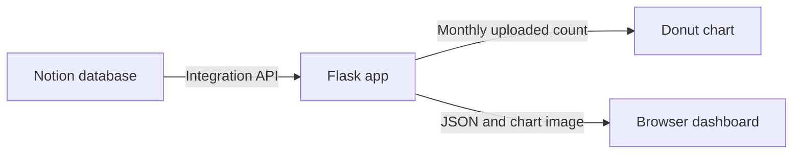

# Notion Chart Maker

Turn a Notion production calendar into a live donut chart showing how many videos have counted toward this month’s upload goal.

## Connect a calendar

1. Share a Notion database with your own integration. The app expects `Name` (title), `Status` (status), and `Upload Due Date` (date). It counts records marked `Uploaded` whose due date is in the current month.
2. Set `NOTION_API_KEY` and `DATABASE_ID` in your shell environment. Keep the integration token outside the repository.
3. Build and start the included Python 3.10 container.

```sh
docker build -t notion-chart-maker .
docker run --rm -p 127.0.0.1:8080:8080 -e NOTION_API_KEY -e DATABASE_ID notion-chart-maker
```

Open [localhost:8080](http://localhost:8080). The chart refreshes from the server, and `/api/interactive-chart` returns the counts and chart image. The goal defaults to five uploads and is set in [main.py](main.py). This version uses the Notion database-query interface pinned by its dependency set.

## Data flow



The app needs a Notion integration with access to the selected database. Bind the container to loopback as shown above, and do not commit or share the integration token.
