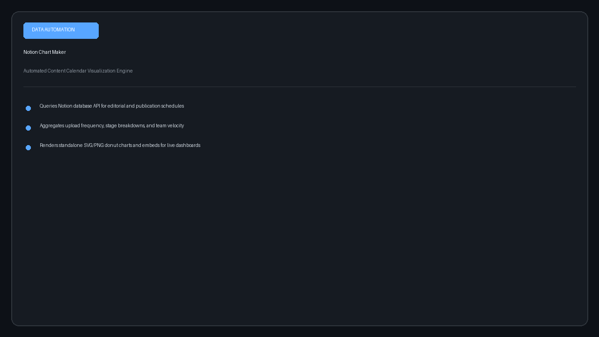

# Notion Chart Maker

> **Automated content calendar analytics and clean vector donut chart generator.**

[](media/walkthrough.mp4)

*Click the preview card above to watch the technical walkthrough.*

---

## Why I Built This

Notion databases are incredible for organizing editorial pipelines and video release calendars, but Notion's native charting options are either locked behind paid add-ons or lack clean visual styling.

NotionChartMaker connects to your Notion database via an internal integration token, aggregates publication velocity and content-type breakdowns, and generates clean high-resolution SVG and PNG charts ready for embedding into public dashboards or reports.

## Standout Features

- **Direct Notion Database Query:** Pulls live status properties, dates, and platform tags directly via the official Notion SDK.
- **Automated Aggregation:** Groups posts by completion state, publishing channel, and weekly delivery targets.
- **Vector Chart Output:** Exports crisp donut and bar charts with customizable color palettes and typography.

## Media

- **Chart Overview:** `media/overview.png`
- **Walkthrough Video:** `media/walkthrough.mp4`

## Configuration

```bash
git clone https://github.com/Invictine/NotionChartMaker.git
cd NotionChartMaker
pip install -r requirements.txt

# Set your credentials
export NOTION_TOKEN="secret_..."
export NOTION_DATABASE_ID="db_..."

python generate_charts.py
```
